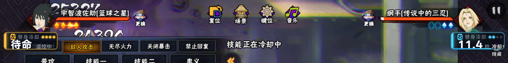
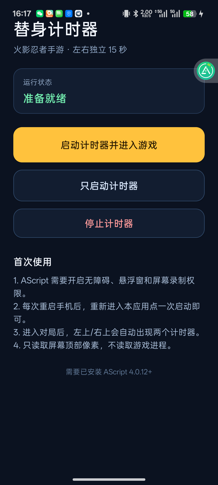

# 火影忍者手游 · 左右替身计时器

[简体中文](README.md) | [English](README_EN.md)

**中文简介：** 基于 AScript 与 OpenCV/NumPy 的火影忍者手游左右替身计时器。识别屏幕 HUD 中的替身点变化，并在对应一侧显示独立的 15 秒倒计时。本文档提供中文说明；下方 English summary 为项目简介。

**English summary:** An AScript timer for Naruto Mobile that reads substitution pip changes from the on-screen HUD and starts an independent 15-second countdown for the left or right side. This README includes a Chinese guide and an English project overview.

通过 **AScript + OpenCV/NumPy** 读取手机屏幕顶部的替身点，自动识别左右两侧各剩几个替身点；任意一侧减少 1 个，就在对应角落显示 15 秒倒计时。连续减少两个会以最后一次减少为准重新计时 15 秒。

- **只读取屏幕像素**：不读取游戏内存、不注入、不修改游戏进程、不模拟点击。
- **无障碍模式运行**：AScript 使用无障碍服务 + 屏幕录制/投屏权限；悬浮窗触摸穿透，不会挡住游戏操作。
- **颜色自适应**：左侧/右侧可能是金色或蓝色，脚本对每一侧同时识别两种颜色。
- **左右完全独立**：左侧减少只启动左上计时器，右侧减少只启动右上计时器；两边状态、计数、倒计时互不影响。
- **增加绝不触发**：替身点增加只同步点数；减少连续 2 帧即触发倒计时。增加不会启动、重置，也不会撤销正在进行的倒计时。
- **复杂战斗防误判**：不再用固定 RGB 阈值判断亮暗，而是比较每个槽位内部与局部背景的相对亮度；4 个槽位必须全部明确可辨才更新，亮暗不明确时直接跳过这一侧，不会乱跳计时。

## 当前状态

手机（PLF110）上已经安装 AScript 4.0.12 和桌面 App「替身计时器」：

- AScript 工程名：`shadow_timer`
- 手机 App 包名：`com.shadowtimer`
- 屏幕：`2392 × 1080`（横屏）
- 悬浮计时器：左上角 / 右上角
- 日志：`/sdcard/airscript/model/shadow_timer/shadow_timer.log`

实机效果（复杂战斗特效下，右侧计时、左侧独立监控）：



## 手机 App（已安装）

已经把启动器做成手机桌面 App，并安装到手机：

- 应用名：**替身计时器**
- 包名：`com.shadowtimer`
- APK：[替身计时器.apk](替身计时器.apk)
- 打开后点 **“启动计时器并进入游戏”**，会自动运行 AScript 工程并切到火影忍者。
- **“只启动计时器”**：留在当前应用，只启动悬浮计时器。
- **“停止计时器”**：停止 AScript 脚本并关闭计时悬浮窗。



> 这个 APK 是轻量桌面启动器，负责一键启动和控制；实际识别引擎仍在 AScript 中运行，所以手机需要保留 AScript 以及已开启的无障碍/悬浮窗/投屏权限。  
> 如果要打包成**完全脱离 AScript 的独立 APK**，需要走 AScript 开发者后台的“发布小程序 → 打包独立 APP”（需要开发者账号），或把识别逻辑原生重写；当前这个 App 是已安装、可直接用的版本。

## 本次修复

- **增加不触发**：替身点增加时只同步点数，日志记录 `INCREASE ... ignored`，不会启动或重置任何计时器。
- **低延迟触发**：连续 2 帧读数一致就立即启动，不再等 0.4 秒；正常识别延迟约 0.1~0.2 秒。
- **进入对局先稳定 1 秒**：避开加载/换人动画造成的启动假减少。
- **计时中不会变回待命**：点数增加、某一侧暂时看不清、全屏大招导致 HUD 短暂消失，都不会取消已经开始的倒计时；计时只会在走满 15 秒或脚本停止时结束。
- **短暂丢失 HUD 不重置计时**：两侧 HUD 同时被遮挡时只暂停识别，保留 UI 上的倒计时；不会执行 `resetAll` 把它清成“待命”。
- **自动适配两种 HUD 布局**：1v1 标准局四个点间距约 30px；3v3/训练场（顶部有队友头像）点位整体内移，识别器会自动切换布局，不再因为换模式而“检测不到”。
- **相对亮度识别**：暗点如果落在较亮的背景/血条上，固定颜色阈值会把暗点误算成亮点。现在每个槽位会比较“菱形内部亮度”与“上下背景亮度”，暗点不会再被算亮。
- **4 槽位全确认**：4 个替身点必须全部明确判为 `lit` 或 `dark`，这一侧才有效；遇到 `uncertain`（技能闪光、颜色混合、遮挡）就跳过，不更新点数，也不启动计时。
- **左右真正独立**：左侧状态和右侧状态是两套独立对象；左侧看不清时右侧仍可正常计时，左侧减少只执行 `HUD.trigger("left", ...)`，右侧只执行 `HUD.trigger("right", ...)`。
- **倒计时不被遮挡打断**：正在倒计时的一侧即使暂时被特效遮住、卡片变暗，倒计时也会继续走。
- **连续减少**：每次减少都会立即重新开始该侧 15 秒；另一边不受影响。
- **回归测试**：
  - `tools/test_state_machine.py` 覆盖增加、遮挡回弹、连续减少、左右独立；
  - `tools/test_detector_frames.py` 用真实截图覆盖“暗点落在亮背景上”和“亮点被亮光干扰”等误判场景。

实机日志验证（增加只记录、减少才启动）：

```text
DECREASE right 3->2
START right timer  15.0s
INCREASE right 2->4 ignored
DECREASE right 4->2
START right timer  15.0s
INCREASE left 3->4 ignored
```

复杂战斗（全屏紫光/闪光）实机验证：右侧替身点 4→2 后立即显示 `11.4 秒`，左侧仍保持独立监控，没有被右侧计时影响。

## 使用步骤

1. 手机安装并打开 **AScript**。
2. 确认 AScript 已获得：
   - **无障碍权限**（系统设置 → 无障碍 → 已下载的应用 → AScript）
   - **悬浮窗权限**
   - **图色权限 / 屏幕录制**：弹窗里建议选 **单个应用 → 火影忍者**；如果只能选整个屏幕，也可以，脚本只处理屏幕顶部 18% 的区域。
3. 启动《火影忍者》手游，进入对局（练习场也可以）。
4. 直接打开桌面 App **「替身计时器」**，点 **“启动计时器并进入游戏”**：
   - 会自动运行 `shadow_timer` 工程并切到火影忍者；
   - 也可以点“只启动计时器”，留在当前应用。
   - 调试时仍可在 AScript 的 Web IDE / 工程列表里手动运行。
5. 两张小计时器会一直显示在左上角和右上角：
   - `待命 / 监控中`：正在识别，尚未触发；
   - `15.0 秒 / 冷却中`：该侧替身点减少，倒计时 15 秒；
   - `可用 / READY`：15 秒结束。
6. 想停止：在 AScript 中停止脚本；悬浮窗会一起关闭。

> 首次运行或重启手机后，系统会重新弹出屏幕录制授权，按提示允许即可。AScript 已加入电池优化白名单，避免后台被冻结。

## 文件说明

```
as_project/
├─ __init__.py          # 主脚本：截图、替身点识别、计时、UI 更新
├─ build.as             # AScript 工程配置（无需额外 pip 安装）
└─ res/ui/timer.html    # 左右计时器悬浮窗 UI（HTML/CSS/JS）
app_src/                # 手机启动器 App 源码（Java，无第三方依赖）
tools/
├─ check_detector.py       # 用参考截图离线查看每个槽位的状态和亮度证据
├─ test_state_machine.py   # 回归测试：增加不触发、连续减少、左右独立
├─ test_detector_frames.py # 回归测试：暗点亮背景、1v1/3v3 两种布局
├─ fixtures/               # 检测回归用的真实截图
└─ ws_log.py               # 开发时连接 AScript WebSocket 日志
替身计时器.as              # 可导入 AScript 的工程包
替身计时器.apk             # 已安装的手机桌面 App
```

`app_build/` 中的构建中间文件和签名密钥不包含在仓库中。

## 识别原理

1. 只截取屏幕顶部 18%：`screen.capture_cv(0, 0, width, height * 0.18)`。
2. 左右各有 4 个固定槽位，位置按屏幕宽高归一化：
   - 左：`x ≈ 0.115 / 0.1275 / 0.140 / 0.1525`
   - 右：`x ≈ 0.8487 / 0.8612 / 0.8737 / 0.8863`
   - 中心：`y ≈ 0.111`
3. 每个槽位同时接受金色和蓝色，计算：
   - 菱形区域内彩色像素占比，用来确认替身点“身体”是否存在；
   - 菱形内部亮度 `vi` 与上下背景亮度 `vo` 的差值，用来区分亮起 / 暗点；
   - 亮暗不明确的槽位记为 `uncertain`，整侧跳过，不更新点数。
4. 用“亮起 → 暗掉”的变化判断消耗：
   - 4 个槽位全部明确后，连续 2 帧读数一致就立即确认减少（约 0.1~0.2 秒）；
   - 左右两侧分别判断有效性和点数，一侧被遮挡不影响另一侧；
   - 只有减少会启动计时；增加只更新点数，绝不会触发或重置倒计时；
   - 左侧减少只调用左上角计时器，右侧减少只调用右上角计时器；
   - 点数减少 1 或 2 时，对应侧重新开始 15 秒；连续减少则每次都重新计时。
5. Python 通过 `WebWindow.call()` 通知 HTML 计时器；真正的倒计时动画在 WebView 内用 `requestAnimationFrame` 完成，画面流畅且不会频繁跨语言调用。

## 换手机 / 改分辨率

脚本使用归一化坐标，一般同比例（约 2.215:1）的横屏手机可直接用。如果替换后识别不到：

1. 用 AScript 截一张游戏对局图，或把截图放到电脑；
2. 用 `tools/check_detector.py` 检查左右 4 个点的 `detail`；
3. 调整 `PIP_Y`、`PIP_HALF_H`，或按实际像素修改 `PIP_SLOTS` 中的归一化 x 值。

`PIP_Y` 是四个替身点中心的纵向位置，`PIP_HALF_H` 是槽位上下容差。  
`PIP_PRESENT_MIN` 控制“菱形里多少彩色像素才算有替身点”；`LIT_ABS_V` / `LIT_ABS_DIFF` / `LIT_DIFF` / `LIT_RATIO` 控制亮起判定；`DARK_V_MAX` / `DARK_DIFF_MAX` 控制暗点判定。  
如果新分辨率下暗点被误判成 `uncertain`，优先检查 `tools/check_detector.py` 输出里的相对亮度差，再微调 `LIT_DIFF` 与 `DARK_DIFF_MAX`。

## 说明

- 本工程仅用于学习和个人辅助，请遵守游戏用户协议；不要用于商业代练、外挂或破坏公平性的用途。
- 不包含任何游戏进程读写、内存修改、注入或自动操作逻辑。
